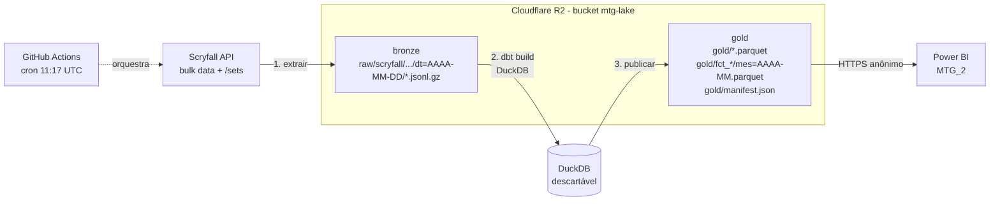
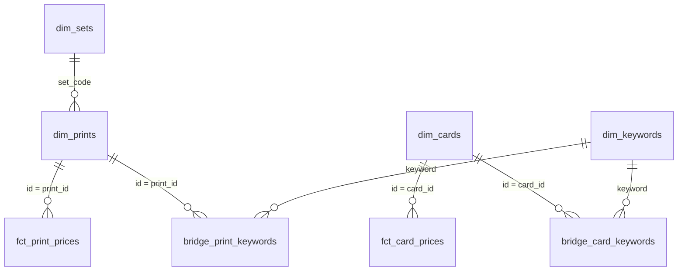

# Guia do MTG Lakehouse

Pipeline diário de dados de Magic: The Gathering:
**Scryfall → GitHub Actions → Cloudflare R2 (lake) → dbt + DuckDB → Parquet → Power BI (MTG_2)**.

Este guia explica a arquitetura e por que ela foi escolhida, e mostra como montar tudo do zero:
em ambiente local, no Cloudflare R2, no GitHub e no Power BI.

---

## Sumário

1. [Arquitetura](#1-arquitetura)
2. [Comparação com o pipeline anterior (Airflow + S3 + Snowflake)](#2-comparação-com-o-pipeline-anterior)
3. [Custos](#3-custos)
4. [Estrutura do repositório](#4-estrutura-do-repositório)
5. [Pré-requisitos](#5-pré-requisitos)
6. [Rodando localmente (sem nuvem)](#6-rodando-localmente-sem-nuvem)
7. [Cloudflare R2](#7-cloudflare-r2)
8. [Carga do histórico legado](#8-carga-do-histórico-legado)
9. [GitHub e agendamento](#9-github-e-agendamento)
10. [Power BI](#10-power-bi)
11. [Operação do dia a dia](#11-operação-do-dia-a-dia)
12. [Testes e CI](#12-testes-e-ci)
13. [Solução de problemas](#13-solução-de-problemas)
14. [Segurança](#14-segurança)
15. [Próximos passos](#15-próximos-passos)

---

## 1. Arquitetura



| Etapa | Comando | O que faz |
|---|---|---|
| 1. Extrair | `python -m mtg_lake extrair` | Baixa `oracle_cards`, `default_cards` (JSONL.gz) e `/sets` e grava na camada **bronze**, particionados por data do snapshot. Se o arquivo do dia já existe, não baixa de novo. |
| 2. Transformar | `python -m mtg_lake transformar` | `dbt build`: o DuckDB lê o JSON direto do lake, monta as dimensões, os preços do dia e os agregados, e roda **33 testes**. Se algum falhar, o pipeline para e nada é publicado. |
| 3. Publicar | `python -m mtg_lake publicar` | Grava as tabelas do schema `gold` como **Parquet**. Os preços entram no histórico mensal (`mes=AAAA-MM.parquet`); só o mês corrente é reescrito. Atualiza o `manifest.json`. |
| 4. Limpar | `python -m mtg_lake limpar` | Apaga arquivos brutos com mais de 14 dias. O histórico de preços já está no gold. |
| Tudo | `python -m mtg_lake diario` | As quatro etapas em sequência. |

### Princípios do desenho

- **O lake é a fonte da verdade.** O DuckDB é só o motor de cálculo: nasce e morre a cada execução. Não há banco para manter, fazer backup ou pagar.
- **Idempotente.** Rodar o mesmo dia duas vezes dá o mesmo resultado. A carga diária *substitui* a data no arquivo do mês, e a carga legada só *completa* o que falta.
- **Formato aberto.** Parquet pode ser lido pelo Power BI, Python, DuckDB, Spark, Snowflake, BigQuery e Excel (via Power Query). Trocar de ferramenta não exige migrar dados.
- **Mesmo código em qualquer lugar.** `MTG_LAKE` pode ser uma pasta local, um bucket R2 ou um bucket S3.

### Tabelas publicadas (substituem os CSVs do notebook)

| CSV antigo | Arquivo novo (gold) | Grão |
|---|---|---|
| `mtg_dimensao.csv` | `dim_cards.parquet` | carta única (oracle) |
| `mtg_dimensao_prints.csv` | `dim_prints.parquet` | impressão |
| `mtg_prices_historic.csv` | `fct_card_prices/mes=*.parquet` | carta × dia |
| `mtg_prices_historic_prints.csv` | `fct_print_prices/mes=*.parquet` | impressão × dia |
| `mtg_sets.csv`, `set_icons.csv` | `dim_sets.parquet` | set |
| `unique_keywords.csv` | `dim_keywords.parquet` + `bridge_card_keywords.parquet` | keyword / carta × keyword |
| `unique_keywords_prints.csv` | `bridge_print_keywords.parquet` | impressão × keyword |
| `keyword_pairs.csv` | `keyword_pairs.parquet` | keyword × texto |
| `set_verbose.csv` | `agg_set_verbose.parquet` | set |
| `year_verbose.csv` | `agg_year_verbose.parquet` | ano |

A coluna `date` dos CSVs de preço agora se chama `price_date`.

---

## 2. Comparação com o pipeline anterior

O projeto `mtg_pipeline` (Airflow + S3 + Snowflake) continua válido. Esta versão parte de uma constatação:
o volume aqui é **um lote por dia de ~100 MB comprimidos**. É um problema pequeno para
ferramentas feitas para escala de empresa.

| | `mtg_pipeline` (Airflow + S3 + Snowflake) | `mtg_lakehouse` (Actions + R2 + dbt/DuckDB) |
|---|---|---|
| Onde roda | No seu PC (Docker + WSL2). Se o PC estiver desligado às 8h, não roda. | Na nuvem do GitHub. O PC pode ficar desligado. |
| Custo mensal | Snowflake após o trial (warehouse + armazenamento) + S3 | **US$ 0** dentro das cotas gratuitas (seção 3) |
| Peças para manter | Airflow (api-server, scheduler, dag-processor, triggerer, Postgres), Docker, WSL2, IAM role, storage integration, roles, warehouse, resource monitor, chave RSA, PAT | 1 workflow, 1 bucket, 1 token |
| Transformação | SQL com macros Jinja próprias, executado pelo Airflow | **dbt**: dependências automáticas, testes declarativos, documentação e lineage |
| Testes | 1 `SQLCheckOperator` com 11 checagens | 33 testes dbt + 9 testes Python + CI a cada push |
| Ambiente de desenvolvimento | Precisa de AWS e Snowflake configurados | Roda 100% local com uma pasta como lake |
| Reprodutibilidade | Clonar + configurar 3 plataformas | Fork + 2 secrets + 5 variables |
| Power BI | Conector Snowflake (PAT) | Web + Parquet (anônimo), sem gateway |
| Escala | Praticamente ilimitada | Uma máquina; folga grande para este volume (o dia inteiro processa em ~1 min) |
| Para o currículo | Airflow e Snowflake (muito pedidos em vagas) | dbt, DuckDB, lakehouse, CI/CD, GitHub Actions (em alta) |

**Quando o anterior faz mais sentido:** se o objetivo for aprender ou demonstrar Airflow e Snowflake;
se o projeto passar a ter muitas fontes com dependências entre si; ou se várias pessoas
precisarem consultar o warehouse por SQL.

**Caminho de evolução:** os modelos dbt são portáveis. Para ir ao Snowflake, troque o adapter
(`dbt-snowflake`) e a sintaxe de JSON (`->>` vira `:campo::string`). Os dados Parquet podem ser lidos
no Snowflake por um stage externo.

---

## 3. Custos

| Serviço | Cota gratuita | Uso estimado deste projeto |
|---|---|---|
| GitHub Actions (repo **privado**) | 2.000 min/mês | ~3–5 min/dia → ~150 min/mês |
| GitHub Actions (repo público) | ilimitado | — |
| Cloudflare R2: armazenamento | 10 GB/mês | ~1,5 GB/ano de histórico de preços + ~45 MB de dimensões |
| Cloudflare R2: operações | 1 milhão de escritas e 10 milhões de leituras por mês | ~20 escritas/dia + leituras do Power BI |
| Cloudflare R2: saída de dados (egress) | **sempre gratuita** | Power BI baixando os Parquet todo dia |
| Power BI Desktop | gratuito | — |

> O R2 exige um cartão de crédito cadastrado para ativar, mesmo no plano gratuito.
> Ao passar de 10 GB, o custo é de ~US$ 0,015 por GB/mês. Pelas estimativas acima, isso levaria anos.

Medido no teste com dados reais (05/10/2026): extração em 12 s, `dbt build` em 47 s, publicação em 3 s.
O histórico legado (780 MB de CSV) virou 235 MB de Parquet em 18 s.

---

## 4. Estrutura do repositório

```
mtg_lakehouse/
├── .github/
│   ├── workflows/diario.yml     # agendamento diário (o "Airflow" deste projeto)
│   ├── workflows/ci.yml         # lint + testes a cada push/PR
│   └── dependabot.yml           # PRs mensais de atualização de dependências
├── mtg_lake/                    # código Python (python -m mtg_lake ...)
│   ├── config.py                # variáveis de ambiente / .env
│   ├── armazenamento.py         # lake: pasta local, R2 ou S3 (mesma interface)
│   ├── extrair.py               # Scryfall -> bronze
│   ├── transformar.py           # roda o dbt
│   ├── publicar.py              # gold -> Parquet + manifest
│   └── manutencao.py            # retenção do bronze + carga legada
├── dbt/
│   ├── dbt_project.yml
│   ├── profiles.yml             # DuckDB + credenciais S3 via env vars
│   ├── macros/scryfall.sql      # JSON -> colunas (mesma lógica do notebook)
│   ├── models/staging/          # leitura do bronze
│   ├── models/intermediate/     # cartas/impressões em colunas
│   ├── models/marts/            # schema gold = o que é publicado
│   └── tests/generic/           # teste volume_minimo
├── powerbi/consultas.pq         # Power Query (M) para o MTG_2
├── tests/                       # pytest + amostra real da Scryfall (fixtures)
├── .env.example
├── requirements.txt             # versões fixadas
└── requirements-dev.txt
```

---

## 5. Pré-requisitos

Não precisa de WSL2 nem de Docker: tudo roda direto no Windows, no macOS ou no Linux.

| Ferramenta | Para quê | Instalação (Windows) |
|---|---|---|
| Git | versionar e enviar ao GitHub | `winget install Git.Git` |
| Python 3.12 | rodar o pipeline local | `winget install Python.Python.3.12` |
| VS Code (opcional) | editar | `winget install Microsoft.VisualStudioCode` + extensões *Python* e *dbt Power User* |
| GitHub CLI (opcional) | cadastrar secrets pelo terminal | `winget install GitHub.cli` |
| Power BI Desktop | dashboard | Microsoft Store |

> **Não clone dentro do OneDrive.** O ambiente virtual (`.venv`) e a pasta `data/` têm milhares de
> arquivos e centenas de MB. A sincronização deixa tudo lento e pode travar arquivos.
> Use, por exemplo, `C:\projetos\mtg_lakehouse`.

---

## 6. Rodando localmente (sem nuvem)

No PowerShell:

```powershell
git clone https://github.com/gustavimcp/mtg-lakehouse.git C:\projetos\mtg_lakehouse
cd C:\projetos\mtg_lakehouse
py -3.12 -m venv .venv
.venv\Scripts\python -m pip install -r requirements-dev.txt
copy .env.example .env
```

No `.env`, deixe `MTG_LAKE=./data/lake` e preencha `SCRYFALL_USER_AGENT` com um contato seu.

```powershell
.venv\Scripts\python -m mtg_lake diario
```

O resultado fica em `data\lake\gold\`. Para inspecionar, abra o DuckDB pelo Python:

```powershell
.venv\Scripts\python -c "import duckdb; print(duckdb.sql(\"SELECT name, usd FROM 'data/lake/gold/dim_cards.parquet' JOIN 'data/lake/gold/fct_card_prices/*.parquet' ON id = card_id ORDER BY usd DESC NULLS LAST LIMIT 10\"))"
```

> Se preferir ativar o ambiente (`.venv\Scripts\Activate.ps1`) e o PowerShell bloquear scripts,
> continue usando `.venv\Scripts\python ...` como acima. Funciona igual e não exige mudar a política de execução.

Comandos úteis:

```powershell
.venv\Scripts\python -m mtg_lake transformar --select dim_cards+   # só dim_cards e o que depende dela
.venv\Scripts\python -m mtg_lake extrair --forcar                  # baixa de novo o snapshot do dia
.venv\Scripts\python -m pytest                                     # testes
```

---

## 7. Cloudflare R2

O R2 é um armazenamento compatível com S3 (o mesmo código e as mesmas bibliotecas) **sem cobrança de saída de dados**.
Isso importa porque o Power BI baixa os arquivos todo dia.
(Para usar AWS S3, veja o fim desta seção.)

### 7.1 Criar o bucket

1. Crie uma conta em <https://dash.cloudflare.com> e abra **R2 Object Storage**. Ao ativar, será pedido um cartão.
2. **Create bucket** → nome `mtg-lake` → localização automática → **Create**.

### 7.2 Liberar leitura pública (para o Power BI)

1. No bucket, abra **Settings → Public access → R2.dev subdomain → Allow**.
2. Copie a URL pública, algo como `https://pub-0123456789abcdef.r2.dev`. Ela será o parâmetro `LakeUrl` no Power BI.
3. Teste no navegador: `https://pub-....r2.dev/gold/manifest.json`. Funciona depois da primeira publicação.

> Isso torna **todo o bucket legível** por quem tiver a URL. Aqui o conteúdo são dados públicos da Scryfall,
> e não há nada pessoal. O subdomínio `r2.dev` tem limite de requisições, suficiente para uso pessoal.
> Se você tiver um domínio na Cloudflare, prefira **Custom Domains** (mais rápido e permite regras de acesso).

### 7.3 Criar o token de acesso (para o pipeline)

1. Em **R2 → Manage API tokens → Create API token** (*Account API token*).
2. Permissão **Object Read & Write**, restrita ao bucket `mtg-lake`.
3. Copie **Access Key ID**, **Secret Access Key** e o endpoint S3: `https://<ACCOUNT_ID>.r2.cloudflarestorage.com`.
   O secret aparece **uma única vez**.

### 7.4 Configurar o `.env` para usar o R2

```ini
MTG_LAKE=s3://mtg-lake
S3_ENDPOINT=<ACCOUNT_ID>.r2.cloudflarestorage.com
S3_REGION=auto
S3_URL_STYLE=path
S3_ACCESS_KEY_ID=<access key id>
S3_SECRET_ACCESS_KEY=<secret access key>
```

O endpoint vai **sem** `https://`. Depois, rode `python -m mtg_lake diario` para a primeira carga.

### 7.5 (Opcional) Regra de ciclo de vida

O comando `limpar` já apaga o bronze antigo. Como rede de segurança, em **Settings → Object lifecycle rules**
crie uma regra com prefixo `raw/` que apaga objetos com mais de 30 dias.

### Alternativa: AWS S3

```ini
MTG_LAKE=s3://<seu-bucket>
S3_ENDPOINT=s3.amazonaws.com
S3_REGION=us-east-1
S3_URL_STYLE=vhost
```

Use as chaves de um usuário IAM com `s3:GetObject`, `s3:PutObject`, `s3:DeleteObject` e `s3:ListBucket` no bucket.
O Power BI precisa de leitura pública do prefixo `gold/` (bucket policy). Lembre que no S3 a saída de dados é cobrada.

---

## 8. Carga do histórico legado

Os CSVs do notebook (`mtg_prices_historic*.csv`, separados por `;`) entram no histórico mensal.
O modo é **completar**: se já existir preço para a mesma carta e data no lake, o do lake prevalece.
Pode rodar quantas vezes quiser.

Com o `.env` apontando para o R2:

```powershell
.venv\Scripts\python -m mtg_lake legado --arquivo "C:\caminho\MTG\mtg_prices_historic.csv" --fato fct_card_prices
.venv\Scripts\python -m mtg_lake legado --arquivo "C:\caminho\MTG\mtg_prices_historic_prints.csv" --fato fct_print_prices
```

Os CSVs não precisam ir para o repositório: a leitura é local e só os Parquet sobem.

---

## 9. GitHub e agendamento

### 9.1 Criar o repositório

Crie um repositório **privado** (ex.: `mtg-lakehouse`) em <https://github.com/new>, sem README. Depois, envie o código:

```powershell
cd C:\projetos\mtg_lakehouse
git init -b main
git add .
git commit -m "MTG Lakehouse: Actions + R2 + dbt/DuckDB"
git remote add origin https://github.com/gustavimcp/mtg-lakehouse.git
git push -u origin main
```

> **Por que privado?** Em repositórios públicos, o GitHub **desativa workflows agendados após 60 dias sem commits**.
> No privado isso não acontece, e o uso (~150 min/mês) fica bem dentro dos 2.000 minutos gratuitos.

### 9.2 Cadastrar secrets e variables

Em **Settings → Secrets and variables → Actions**:

| Tipo | Nome | Valor |
|---|---|---|
| Secret | `S3_ACCESS_KEY_ID` | access key do token R2 |
| Secret | `S3_SECRET_ACCESS_KEY` | secret do token R2 |
| Variable | `MTG_LAKE` | `s3://mtg-lake` |
| Variable | `S3_ENDPOINT` | `<ACCOUNT_ID>.r2.cloudflarestorage.com` |
| Variable | `S3_REGION` | `auto` |
| Variable | `S3_URL_STYLE` | `path` |
| Variable | `SCRYFALL_USER_AGENT` | `MTGLakehouse/1.0 (seu-email@exemplo.com)` |

Ou com o GitHub CLI:

```powershell
gh secret set S3_ACCESS_KEY_ID
gh secret set S3_SECRET_ACCESS_KEY
gh variable set MTG_LAKE --body "s3://mtg-lake"
gh variable set S3_ENDPOINT --body "<ACCOUNT_ID>.r2.cloudflarestorage.com"
gh variable set S3_REGION --body "auto"
gh variable set S3_URL_STYLE --body "path"
gh variable set SCRYFALL_USER_AGENT --body "MTGLakehouse/1.0 (seu-email@exemplo.com)"
```

### 9.3 Primeira execução

**Actions → pipeline-diario → Run workflow**. Em ~3–5 minutos, cada etapa aparece com seu log,
e o resumo mostra o snapshot processado. A partir daí, roda sozinho todo dia às **11:17 UTC (08:17 em Brasília)**.

O comando equivalente pelo CLI:

```powershell
gh workflow run pipeline-diario
gh run watch
```

### 9.4 Avisos de falha

O GitHub envia e-mail quando um workflow agendado falha. O aviso vai para quem criou ou alterou por último
a linha `cron`. Confira em **Settings (do seu perfil) → Notifications → Actions**.

> O GitHub pode atrasar execuções agendadas em horários de pico, geralmente por alguns minutos.
> Por isso o cron usa o minuto 17 e não 00.

---

## 10. Power BI

### 10.1 Montar as consultas

O arquivo [`powerbi/consultas.pq`](../powerbi/consultas.pq) tem todo o código M. Resumo:

1. **Parâmetros:** `LakeUrl` (URL pública do R2, sem barra no final) e `MesesHistorico` (0 = tudo).
2. **`Manifesto`:** lê `gold/manifest.json`, que é o índice de todos os arquivos. Desabilite a carga.
3. **`fnLerParquet`:** função que baixa um arquivo e o abre com `Parquet.Document`. Desabilite a carga.
4. **Uma consulta por tabela:** `fnLerParquet(Manifesto[tabelas][dim_cards])` etc.
5. **Fatos:** combinam todos os arquivos mensais listados no manifesto (ou só os últimos N meses).

Para migrar o MTG_2 sem refazer visuais, abra cada consulta antiga baseada em CSV no Editor Avançado
e troque apenas o passo **Fonte** pela leitura do Parquet correspondente (tabela da seção 1).
Mantenha o nome da consulta. Lembre de `date` → `price_date` nos preços.

### 10.2 Modelo



- Crie uma tabela calendário e relacione com `price_date` nos dois fatos.
- Nas pontes de keyword, use filtro cruzado **bidirecional** apenas na relação ponte → dimensão de cartas,
  ou use medidas com `CROSSFILTER`.

### 10.3 Publicar e agendar a atualização (Power BI Service)

1. Publique o relatório.
2. Em **Configurações do modelo semântico → Credenciais da fonte de dados → Editar**:
   - Autenticação **Anônima**, nível de privacidade **Público**.
   - Marque **Ignorar conexão de teste**. A raiz do bucket responde 404, o que faz o teste falhar mesmo com tudo certo.
3. **Gateway:** não é necessário (fonte web pública).
4. **Atualização agendada:** 09:00 (horário de Brasília). O pipeline termina por volta das 08:25.

> **Tamanho do modelo:** o fato por impressão ganha ~3,4 milhões de linhas por mês. Se o modelo
> ficar pesado (limite de 1 GB no Pro), use `MesesHistorico` (ex.: 12) ou mantenha o histórico longo só em
> `fct_card_prices`, que é ~3× menor.

---

## 11. Operação do dia a dia

| Situação | O que fazer |
|---|---|
| Ver se rodou hoje | Aba **Actions** do repositório, ou `gh run list --workflow pipeline-diario` |
| Reprocessar o dia | **Run workflow** (com "forcar" marcado se quiser baixar o JSON de novo) |
| Reprocessar um dia passado (até 14 dias) | Localmente: `python -m mtg_lake transformar --snapshot AAAA-MM-DD` e `python -m mtg_lake publicar --snapshot AAAA-MM-DD` |
| Adicionar uma coluna | Edite `dbt/macros/scryfall.sql` (`colunas_carta`), rode `pytest`, faça commit. A próxima execução já publica. |
| Adicionar uma tabela | Crie `dbt/models/marts/<nome>.sql` e descreva-a em `_marts.yml`. Todo modelo em `marts` é publicado automaticamente e entra no manifesto. |
| Documentação navegável dos modelos | `cd dbt` → `dbt docs generate --vars "{snapshot_date: AAAA-MM-DD}"` → `dbt docs serve` |
| Atualizar dependências | O Dependabot abre PRs mensais. O CI testa cada um; se passar, faça o merge. |

---

## 12. Testes e CI

**Testes do dbt** (a cada execução, antes de publicar):

- Volume mínimo: 25 mil cartas únicas, 80 mil impressões e 500 sets. Um arquivo truncado da Scryfall é barrado aqui.
- Chaves únicas e não nulas em todas as dimensões e nos preços do dia.
- Integridade: todo preço aponta para uma carta ou impressão existente.
- Valores aceitos (`rarity`) e relação impressão → set (como alerta, sem bloquear).

**Testes Python** (`pytest`, em `tests/`) rodam o pipeline inteiro sobre uma **amostra real** da Scryfall
(275 cartas, 1.084 impressões, incluindo cartas de duas faces, split, tokens e emblemas). Verificam:

- remoção de extras;
- cartas de duas faces;
- fatos completos e sem duplicados;
- publicação idempotente;
- carga legada que não sobrescreve preços existentes;
- retenção do bronze.

**CI** (`.github/workflows/ci.yml`): a cada push ou PR, roda `ruff` (lint e formatação) e `pytest`,
sem internet e sem credenciais.

---

## 13. Solução de problemas

| Sintoma | Causa provável | Solução |
|---|---|---|
| Etapa "Conferir configuração" falha | Variable `MTG_LAKE` não cadastrada | Seção 9.2 |
| `volume_minimo` falhou | Arquivo da Scryfall incompleto ou API instável | Rode de novo com "forcar" marcado |
| `403 Forbidden` / `AccessDenied` | Token sem permissão no bucket, ou chaves trocadas | Recrie o token (7.3) e confira os secrets |
| `Could not establish connection` / erro de endpoint | `S3_ENDPOINT` com `https://` ou ACCOUNT_ID errado | Use só `<id>.r2.cloudflarestorage.com` |
| `Nenhum snapshot encontrado` | `transformar` ou `publicar` rodou sem `extrair` antes | Rode `extrair` ou passe `--snapshot` |
| Workflow agendado não roda | Repositório público sem atividade por 60 dias, ou atraso do GitHub | Torne privado ou reative em Actions |
| Power BI: `Web.Contents` com 404 | `LakeUrl` com barra no final, ou ainda não publicado | Abra a URL do manifesto no navegador |
| Power BI Service: "fonte de dados dinâmica não pode ser atualizada" | Consulta montando a URL inteira com texto | Use sempre `Web.Contents(LakeUrl, [RelativePath = ...])` |
| Power BI mostra dados de ontem | Atualização agendada antes do pipeline terminar | Agende a atualização para depois das 08:30 |
| `dbt` lento ou sem memória localmente | Pouca RAM | Feche programas. O DuckDB usa até 80% da RAM; o runner do GitHub tem 7 GB (privado) |

---

## 14. Segurança

- [ ] `.env` fora do git (já está no `.gitignore`). As credenciais de produção ficam só em **GitHub Secrets**.
- [ ] Token do R2 com **Object Read & Write restrito ao bucket** `mtg-lake`, nunca *Admin*.
- [ ] Leitura pública só no bucket do projeto, que contém dados públicos da Scryfall.
- [ ] Workflows com `permissions: contents: read`, o mínimo necessário.
- [ ] Recriar o token se ele aparecer em log, print ou commit. Depois, atualize o secret.
- [ ] Dependabot ativo e CI obrigatório antes do merge (Settings → Branches → regra para `main`).

---

## 15. Próximos passos

- **dbt docs no GitHub Pages:** publicar a documentação e o lineage dos modelos a cada deploy.
- **Alertas de preço:** um modelo `alertas_preco` (variação > X% em 7 dias) e uma etapa que envia a lista por e-mail ou Discord.
- **dbt source freshness:** alertar se o snapshot da Scryfall não mudar por mais de 2 dias.
- **MotherDuck:** se quiser consultar o histórico por SQL de qualquer lugar, apontar o DuckDB para o MotherDuck. O plano gratuito cobre este volume.
- **Formato de tabela (Iceberg/DuckLake):** quando o histórico crescer muito, para ter time travel e evolução de schema sem reescrever arquivos.
